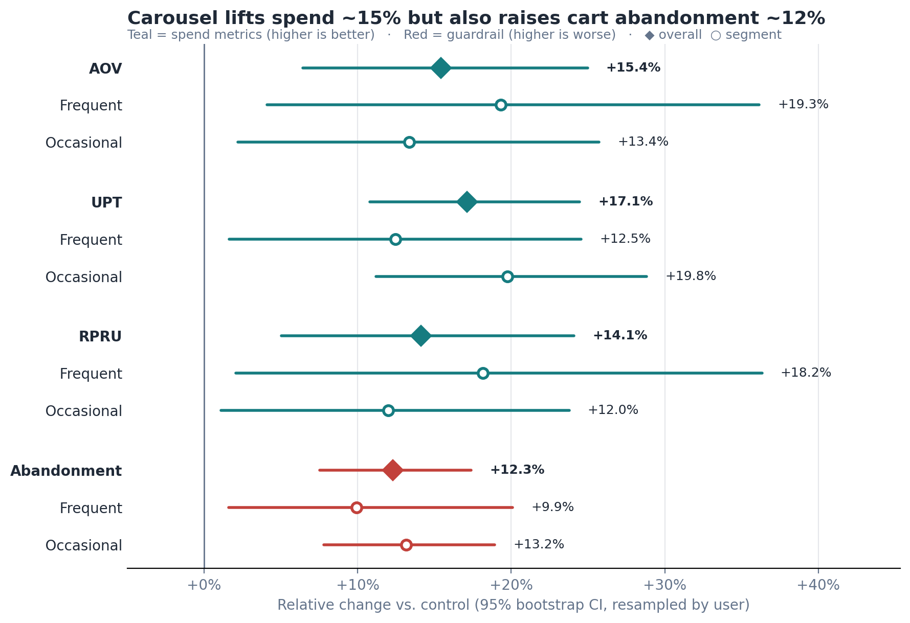

# Personalized Checkout A/B Test

End-to-end A/B test analysis of a personalized "Last-Minute Additions" checkout carousel
for a retail app (~200K active users). It covers experiment design, a PostgreSQL
aggregation pipeline, statistical inference in Python, and a business recommendation.

**SQL (PostgreSQL)** · **Python (pandas, SciPy, statsmodels)** · **Experiment design** · **Tableau**

> **Business question:** Does a personalized checkout carousel increase spend per order
> without raising cart abandonment, and does the effect differ between frequent and
> occasional shoppers?

---

## Results



| Metric | Control | Treatment | Lift | p-value |
| --- | --- | --- | --- | --- |
| Average Order Value (AOV) | $46.41 | $53.56 | **+15.4%** | 0.0005 |
| Units Per Transaction (UPT) | 3.48 | 4.08 | **+17.1%** | < 0.0001 |
| Revenue per Revenue-Generating User (RPRU) | $85.63 | $97.72 | **+14.1%** | 0.0023 |
| Cart abandonment *(guardrail)* | 22.18% | 24.91% | **+12.3% rel.** | < 0.0001 |

**Key findings**

- **The carousel works.** All three spend metrics rose significantly. The sample split
  passed a Sample Ratio Mismatch check (χ² p = 0.66).
- **It has a cost.** Cart abandonment rose 2.7 percentage points. That result holds when
  sessions are grouped by user, to account for repeat sessions from the same person.
- **The net effect is positive.** Revenue per assigned user, which includes the revenue
  lost to extra abandoned carts, rose ~12% (p = 0.009). Annualized, that projects to
  **~$7.3M** in incremental revenue for a full rollout, or **~$3.6M** for frequent
  shoppers alone.
- **The segment difference is directional only.** Frequent shoppers showed a larger
  spend lift and a smaller abandonment increase, but the treatment × segment interaction
  tests are not significant (AOV p = 0.53, RPRU p = 0.18).

**Recommendation:** Roll out in phases. Start with frequent shoppers, who have the lowest
baseline abandonment and the strongest directional response. Add an easier skip/dismiss
option before extending to occasional shoppers, and keep abandonment as a standing
guardrail.

📄 [**Executive memo (PDF)**](memo/executive_summary.pdf) · 📓 [**Analysis notebook**](notebooks/analysis.ipynb) · 🗄️ [**SQL pipeline**](sql/02_aggregation_query.sql)

---

## Experiment Design

| | |
| --- | --- |
| **Population** | App users reaching checkout during a 90-day window (13,059 assigned of 20,000 users) |
| **Control** | Standard flow: cart → payment |
| **Treatment** | "Last-Minute Additions" carousel of personalized add-ons under $15, shown before payment |
| **Randomization unit** | User, assigned once at their first in-window checkout and fixed after that, so no user appears in both arms |
| **Segment** | *Frequent* = 3+ completed orders in the 90 days **before** assignment; otherwise *occasional* (pre-treatment, fixed threshold) |

| Type | Metric | Question it answers |
| --- | --- | --- |
| Primary | AOV | Did the dollar value per transaction increase? |
| Primary | RPRU | Did buyers spend more in total? |
| Secondary | UPT | Did they buy more items, or just pricier ones? |
| Guardrail | Cart abandonment rate | Did the extra step add friction that drove buyers away? |

## Methodology

**1. SQL: build analysis-ready tables** ([`sql/`](sql/))

Four normalized tables are joined into two outputs:
- a **user-level** table (segment, sessions, abandonment, total spend)
- an **order-level** table (AOV and UPT)

They're kept separate because averaging per-user averages would over-weight users who
place few orders. Join and filter decisions (LEFT vs. INNER, `ON` vs. `WHERE`,
`COUNT(col)` vs. `COUNT(*)`, DATE/TIMESTAMP casting) are documented in
[`sql_decisions.md`](sql/sql_decisions.md).

**2. Python: statistical inference** ([`notebooks/analysis.ipynb`](notebooks/analysis.ipynb))

- Sample Ratio Mismatch check (chi-square goodness-of-fit)
- Welch's t-tests for AOV, UPT and RPRU (skewed spend, unequal variances)
- Two-proportion z-test for abandonment, plus a user-level robust binomial GLM, since
  sessions are not independent
- Treatment × segment interaction tests, plus Holm–Bonferroni correction across segment tests
- 95% bootstrap confidence intervals, resampling users to match the randomization unit
- Revenue projection net of abandonment losses

**3. Tableau: stakeholder dashboard** (in progress; design spec in
[`dashboard/dashboard_design.md`](dashboard/dashboard_design.md))

## Data

The data is **synthetic**, produced by [`scripts/generate_data.py`](scripts/generate_data.py)
with a fixed seed. Effect sizes are embedded in the generator and recovered through the
analysis rather than read off the script.


<details>
<summary>Table definitions</summary>

| Table | Key columns | Notes |
| --- | --- | --- |
| `users` | `user_id` (PK), `signup_date`, `platform` | 20,000 users, iOS / Android |
| `experiment_assignments` | `assignment_id` (PK), `user_id` (FK, unique), `variant`, `first_assigned_ts` | One fixed assignment per user |
| `checkout_sessions` | `session_id` (PK), `user_id` (FK), `session_ts`, `completed` | `completed = false` → abandoned cart |
| `orders` | `order_id` (PK), `session_id` (FK, unique), `order_amount`, `unit_count`, `order_date` | At most one order per completed session |

Full DDL with constraints: [`sql/01_schema.sql`](sql/01_schema.sql)
</details>

## Repository Structure

```
├── README.md
├── requirements.txt
├── assets/
│   ├── lift_summary.png             # results chart (generated by the notebook)
│   └── schema_diagram.png
├── data/
│   ├── raw/                         # generated source tables
│   │   ├── users.csv
│   │   ├── experiment_assignments.csv
│   │   ├── checkout_sessions.csv
│   │   └── orders.csv
│   └── processed/                   # SQL outputs used by the notebook
│       ├── user_level_analysis.csv
│       └── order_level_analysis.csv
├── sql/
│   ├── 01_schema.sql                # DDL: tables, keys, constraints
│   ├── 02_aggregation_query.sql     # user-level and order-level aggregation
│   └── sql_decisions.md             # rationale for non-obvious query choices
├── notebooks/
│   └── analysis.ipynb               # SRM, hypothesis tests, CIs, segments, revenue
├── scripts/
│   └── generate_data.py             # seeded synthetic data generator
├── dashboard/
│   └── dashboard_design.md          # Tableau dashboard layout and color spec
└── memo/
    └── executive_summary.pdf        # one-page stakeholder recommendation
```

## Reproduce

```bash
pip install -r requirements.txt

# 1. (Optional) regenerate raw data. Seeded, so the output is identical.
python scripts/generate_data.py

# 2. Load into PostgreSQL
createdb upsell_ab_test
psql -d upsell_ab_test -f sql/01_schema.sql
psql -d upsell_ab_test -c "\copy users FROM 'data/raw/users.csv' CSV HEADER"
psql -d upsell_ab_test -c "\copy experiment_assignments FROM 'data/raw/experiment_assignments.csv' CSV HEADER"
psql -d upsell_ab_test -c "\copy checkout_sessions FROM 'data/raw/checkout_sessions.csv' CSV HEADER"
psql -d upsell_ab_test -c "\copy orders FROM 'data/raw/orders.csv' CSV HEADER"

# 3. Run the two queries in sql/02_aggregation_query.sql and export the results to
#    data/processed/ (the processed CSVs are committed, so this step is optional)

# 4. Run the analysis
jupyter notebook notebooks/analysis.ipynb
```

## Scope & Limitations

- **Synthetic data:** the project demonstrates method, not a real-world effect.
- **One treatment, one segmentation cut** (frequent vs. occasional), and a single
  guardrail metric.
- **Fixed assignment:** variant is fixed at first exposure. The analysis does not model
  novelty or fatigue from seeing the carousel repeatedly.
- **Annualization:** the projection assumes the 90-day effect holds for a full year with
  no decay. Treat it as an upper bound.
- **Segment results are exploratory:** most segment-level tests do not survive
  Holm–Bonferroni correction.

---

**Daniel Igbokwe** · MS Business Analytics, Boston University · [GitHub](https://github.com/danieligbokwe)
