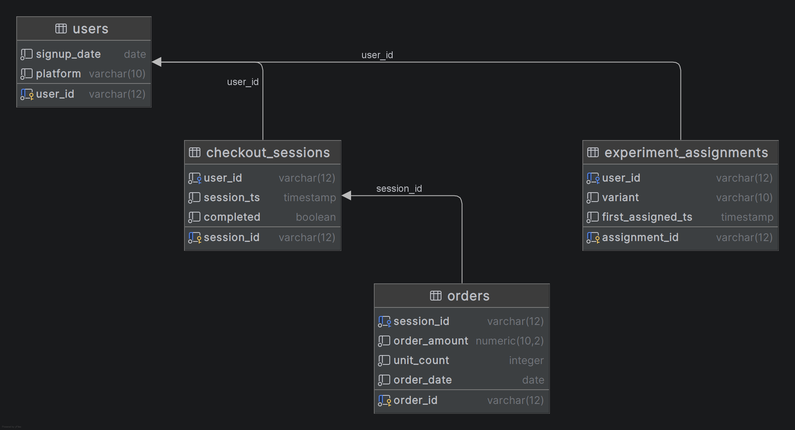

# Personalized Checkout A/B Test

## Business Question

Does a personalized "Last-Minute Additions" checkout carousel increase spend per order
without raising cart abandonment and does the effect differ between frequent and occasional
shoppers?

## Company

Fictional retail app with an active user base of approximately 200,000
users.

## The Feature

**One-Click Smart Upsells at Checkout** — a "Last-Minute Additions" carousel
displayed after the user clicks checkout but before final payment
confirmation, featuring personalized, low-friction add-ons under $15. The
carousel surfaces multiple personalized suggestions per checkout,
occasionally leading to substantially larger add-on baskets.

## Experiment Design

- **Population:** app users reaching checkout
- **Control:** goes straight from cart to payment, no carousel
- **Treatment:** encounters the "Last-Minute Additions" carousel before
  payment confirmation
- **Randomization unit:** user, assigned once at their first checkout session
  during the experiment window, and fixed for all subsequent sessions (not
  re-randomized per session — this avoids the same user appearing in both
  groups and keeps observations independent)

### Metrics

| Type      | Metric                                     | What It Proves                                                   |
| --------- | ------------------------------------------ | ---------------------------------------------------------------- |
| Primary   | Average Order Value (AOV)                  | Did the total dollar value per transaction increase?             |
| Primary   | Revenue per Revenue-Generating User (RPRU) | Did the feature get existing buyers to spend more heavily?       |
| Secondary | Units Per Transaction (UPT)                | Did they buy more items, or just more expensive items?           |
| Guardrail | Cart Abandonment Rate                      | Did the spend-nudge add too much friction and scare buyers away? |

- **Segmentation:** frequent vs. occasional shopper, derived from completed
  order count in the 90 days prior to the user's first assignment (a fixed
  threshold, not a median split, to keep the segment definition stable across
  runs of the analysis)
- **Pre-analysis check:** Sample Ratio Mismatch (chi-square goodness-of-fit)
  on the control/treatment split before trusting any downstream result.
- **Business translation:** AOV/RPRU lift, by segment, converted to
  projected incremental revenue.

## Data Schema



**users**

| Column      | Type         | Notes                                       |
| ----------- | ------------ | ------------------------------------------- |
| user_id     | VARCHAR (PK) | prefixed alphanumeric, e.g.`usr_9f2k1a3c` |
| signup_date | DATE         |                                             |
| platform    | VARCHAR      | iOS / Android                               |

**experiment_assignments**

| Column            | Type         | Notes                                                       |
| ----------------- | ------------ | ----------------------------------------------------------- |
| assignment_id     | VARCHAR (PK) | prefixed alphanumeric, e.g.`asn_...`                      |
| user_id           | VARCHAR (FK) | unique — one fixed assignment per user                     |
| variant           | VARCHAR      | control / treatment                                         |
| first_assigned_ts | TIMESTAMP    | timestamp of the checkout session that triggered assignment |

**checkout_sessions**

| Column     | Type         | Notes                                  |
| ---------- | ------------ | -------------------------------------- |
| session_id | VARCHAR (PK) | prefixed alphanumeric, e.g.`ses_...` |
| user_id    | VARCHAR (FK) |                                        |
| session_ts | TIMESTAMP    |                                        |
| completed  | BOOLEAN      | false = cart abandoned                 |

**orders**

| Column       | Type         | Notes                                             |
| ------------ | ------------ | ------------------------------------------------- |
| order_id     | VARCHAR (PK) | prefixed alphanumeric, e.g.`ord_...`            |
| session_id   | VARCHAR (FK) | unique — at most one order per completed session |
| order_amount | DECIMAL      | > 0                                               |
| unit_count   | INT          | > 0                                               |
| order_date   | DATE         |                                                   |

## Tech Stack

- **Database:** PostgreSQL, local instance
- **SQL client:** DataGrip
- **Data generation & analysis:** Python

## Tooling Breakdown (each tool does distinct work, not redundant passes)

**SQL** — build one clean user-level (and session-level, where needed)
analytical table joining `users`, `experiment_assignments`,
`checkout_sessions`, and `orders`; derive frequency segment, per-user
and per-session metrics, and the abandonment flag. Query logic is intentionally
not specified here — that design and implementation is the author's own work.

**Python** — statistical inference on the SQL output:

- SRM check (chi-square goodness-of-fit on variant assignment counts)
- t-test / Welch's t-test: AOV, control vs. treatment
- t-test: RPRU, control vs. treatment
- t-test: UPT, control vs. treatment
- Two-proportion z-test: cart abandonment rate, control vs. treatment
- Segment cut: frequent vs. occasional shopper, applied to primary metrics
- Revenue/lift translation: dollar impact projection

**Tableau** — stakeholder-facing dashboard:

- AOV by variant
- RPRU by variant
- UPT by variant
- Cart abandonment rate by variant
- Metrics split by frequent/occasional segment
- Projected revenue impact

## File Structure

```
upsell-ab-test/
├── README.md
├── data/
│   ├── raw/                  # generated CSVs, one per table
│   │   ├── users.csv
│   │   ├── experiment_assignments.csv
│   │   ├── checkout_sessions.csv
│   │   └── orders.csv
│   └── processed/            # SQL aggregation output — analysis-ready table(s)
│       └── user_level_analysis.csv
├── sql/
│   ├── schema.sql             # CREATE TABLE statements, DDL only
│   └── aggregation_query.sql  # join/derivation logic
├── notebooks/
│   └── analysis.ipynb         # SRM check, t-tests, segment analysis, revenue/lift translation
├── scripts/
│   └── generate_data.py       # synthetic data generator
├── dashboard/
│   └── upsell_ab_test.twbx    # Tableau workbook
├── memo/
│   └── executive_summary.md   # 1-page business-facing recommendation
└── requirements.txt
```

## Deliverables

- SQL scripts (aggregation pipeline)
- Python notebook (SRM check, t-tests, segment analysis, revenue projection)
- Tableau dashboard
- 1-page executive memo (business-facing summary and recommendation)
- Clean GitHub repo

## Out of Scope

- No more than one segmentation cut (frequent vs. occasional shopper only)
- No multi-armed testing (control vs. one treatment only)
- No additional guardrail metrics beyond cart abandonment rate
- No returns/refunds tracking (treated as unrelated to the experiment)
- No causal modeling beyond the t-test / two-proportion z-test framework
- No session-level re-randomization (variant is fixed per user)

## Known Limitations (for README)

- A user's variant is fixed at first assignment; if a user's shopping
  behavior or context changes meaningfully over the course of the experiment
  window, later sessions still reflect their original assignment.
- Synthetic data assumes independent checkout sessions; no explicit modeling
  of cross-session learning or fatigue effects from repeated carousel
  exposure.

## Timeline

Schema and scope finalized. Tables created in PostgreSQL via DataGrip.
Synthetic data generation is the next step, followed by SQL aggregation and
Python analysis.
